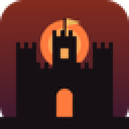

# ⚔ Reino de Ceniza ⚔

*Dragones, castillos y un rey que no quiso morir.*

Servidor medieval de Minecraft **Java 1.20.1 con Forge 47.4.28**: Ice and Fire, L_Ender's Cataclysm,
castillos, catacumbas, Terralith, armaduras de caballero y una historia de 40 misiones para jugar en equipo.

## Descargar e instalar (Windows)

1. Baja **[Reino-de-Ceniza-Windows.zip](../../releases/latest/download/Reino-de-Ceniza-Windows.zip)** (7 KB).
2. Descomprímelo y haz doble clic en **`instalar.bat`**.
   Si Windows avisa: *Más información → Ejecutar de todas formas*.
3. El instalador descarga todo de sus sitios oficiales (unos 260 MB) y comprueba la huella de cada archivo:
   SKLauncher, Java 17, Forge 1.20.1-47.4.28, 31 mods y 2 shaders.
   - **Si no tienes launcher**, instala SKLauncher. Ábrelo una vez, entra con tu nombre de jugador,
     ciérralo y vuelve a hacer doble clic en `instalar.bat`.
4. En tu launcher elige el perfil **Reino de Ceniza** y dale a Jugar.
5. Multijugador → Agregar servidor → la dirección que te pase Ariel.

Los mods quedan en `%APPDATA%\.minecraft\instancias\reino-de-ceniza`, así que no tocan tus otros mods.
Para actualizar, baja el zip nuevo y vuelve a ejecutar `instalar.bat`: solo descarga lo que cambió.

### De dónde sale cada cosa

| Qué | Origen |
|---|---|
| Mods y shaders | [Modrinth](https://modrinth.com) (FTB Quests/Library/Teams: maven oficial de FTB) |
| Forge | maven.minecraftforge.net |
| Java 17 | Eclipse Temurin (Adoptium) |
| SKLauncher | github.com/sklauncher/installer |

## En el juego

- **M**: mapa · mirar un bloque o mob muestra su nombre y vida.
- Al entrar recibes el libro **Crónicas del Reino de Ceniza** con la historia y las misiones.
- **O**: shaders (vienen apagados). Complementary es el bonito; MakeUp Ultra Fast, para PC modestas.
- Si el servidor te rechaza, pide que te agreguen a la lista blanca.
